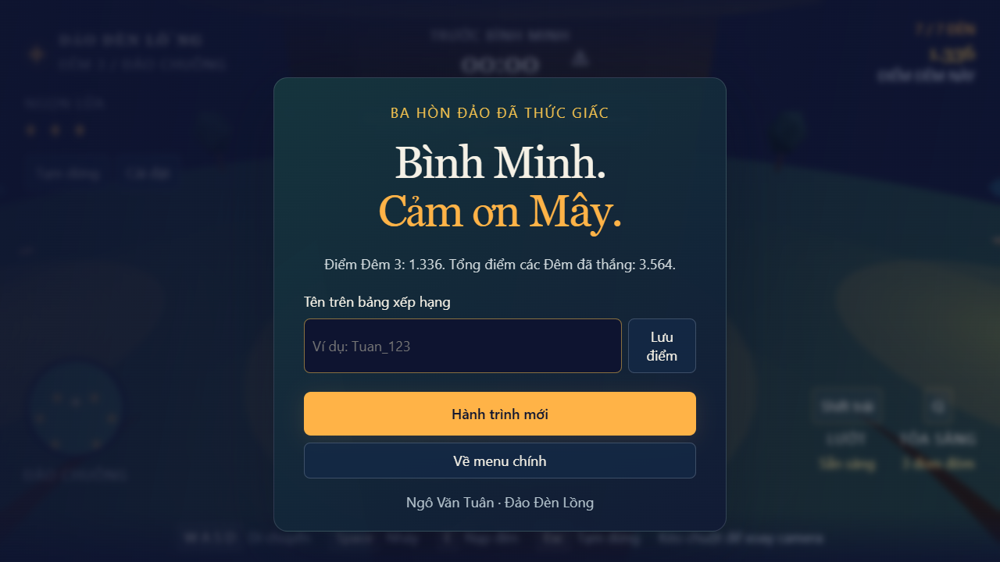

# Đảo Đèn Lồng — v1.0.0 (Phase 4)

**Ngô Văn Tuân · 2A202603630 · L3A** · 26ai.tuannv3@vinuni.edu.vn

Game 3D: cùng Mây gom đom đóm, thắp và giữ ít nhất 60% đèn sáng tới bình minh qua ba hòn đảo. Contract v1.3 giữ toàn bộ luật v1.2. Tag/Release đang chờ chủ bài chốt.



## Cài và chơi — 3 lệnh

```sh
npm ci
npm run build
npm start
```

Mở **http://localhost:4173**. Yêu cầu Node.js ≥22, Windows/macOS/Linux, Chrome/Edge/Firefox mới với WebGL2 và hardware acceleration. Không CDN; Three.js và license được đóng kèm. RAM khuyến nghị 4 GB; GPU tích hợp hiện đại. Benchmark tự mở Chrome/Edge đã cài, cần desktop session; có thể đặt `CHROME_BIN` tới browser executable. Không cần Python để chơi, build, test, bench hay soak.

Release ZIP `artifacts/dao-den-long-v1.0.0.zip` chứa source, `dist/`, license, proof và demo. Giải nén, chạy `npm start` trong thư mục `dao-den-long-v1.0.0` để dùng bản đã build, không cần tải dependency. Leaderboard cần Node server kèm theo; host chỉ `dist/` vẫn chơi được nhưng không có API lưu bảng điểm. Không mở bằng `file://`. ZIP/Release chưa được publish trước khi người dùng chốt.

## Điều khiển và accessibility

| Phím mặc định | Hành động |
|---|---|
| WASD / mũi tên | Đi theo hướng camera |
| Space | Nhảy |
| Shift | Lướt 14 m/s, 0.2 s; hồi 1.5 s |
| E | Nạp, thắp lại hoặc châm dầu cho đèn gần nhất trong 2 m |
| Q | Tỏa sáng: tốn 3 đom đóm, bán kính 3D 5 m; hồi 3 s |
| Esc / P | Pause/resume |
| Kéo / lăn chuột | Xoay / zoom camera |

Cài đặt cho đổi đủ 9 hành động, báo trùng phím, khôi phục mặc định; tự lưu trong browser. Alias mặc định nhường chỗ cho phím mới. Có volume, sensitivity, palette dễ phân biệt, reduce motion và chữ lớn ×1.25. Chữ UI tối thiểu 18 px ở 1280×720. Reduce motion tắt nhấp nháy đồng hồ, vòng pulse và lá bay; renderer không dùng rung camera/chớp toàn màn hình. Caption báo shade xuất hiện kèm mũi tên mép màn hình, gió sắp đến, 10 giây cuối và đèn dưới 30 dầu. Bản đồ nhỏ chỉ đèn, đom đóm và kẻ địch.

## Luật và điểm

Đêm dài 240/270/300 s, cần còn 3/5, 4/6, 5/7 đèn khi dawn. Hết máu ưu tiên thua, kể cả tick cuối. Không thắng sớm khi tất cả đèn sáng. Pause tăng tick nhưng đóng băng sim_tick và timer.

Thắp lần đầu cần 10 đom đóm, thắp lại cần 5; dầu đầy 100, hao 1/s. E châm 10 dầu/đom đóm, lấy ceil lượng cần tới 100. Dầu ≥30 cho shield 6 m; dưới 30 shade có thể hút thêm 5 dầu/s mỗi con. Pulse đẩy/stun bóng; refuel phục hồi shield. Capacity = min(20, 10 + 2 × số lần thắp thành công), reset mỗi Đêm. Prelit scenario không tính thành công.

Điểm +5/đom đóm nạp/châm, +100 first light, +40 relight, +5/bóng bị pulse (tổng +15 nếu đang drain). Dawn: mỗi đèn sáng +50+floor(dầu thật), mỗi máu +50. Campaign chỉ cộng Đêm đã thắng. Retry giữ Đêm hiện tại; thắng Đêm 3 tới Bình Minh.

Sau thua hoặc Bình Minh, nhập tên 3–12 ký tự `[A-Za-z0-9_]` để lưu top 10 trên đĩa `data/leaderboard.json`. Score giảm dần, bằng điểm thì thời gian đạt sớm hơn. Menu có Bảng xếp hạng. Cùng nguồn lưu được dùng khi export:

```sh
node scripts/serve.mjs --export-leaderboard out.json
```

`data/`, `tmp/`, `artifacts/`, `ng.txt` không commit. Dùng `--data-file path.json` để tách leaderboard kiểm thử.

## Test, headless, benchmark và soak

```sh
npm test
npm run verify
node scripts/browser-qa.mjs
node src/headless.mjs --seed 42 --night 1 --ticks 14400 --snapshot-every 60 --out run.jsonl
node scripts/bench.mjs --seed 42 --duration 30 --out bench.json
node --jitless --expose-gc --max-semi-space-size=1 scripts/soak.mjs --seed 7 --nights 10 --out soak.json
```

Headless thêm `--inputs frames.json`, `--scenario scenario.json`; format xem [Contract](game.contract.json) và `tests/scenarios/phase-3/`. Snapshot tick 0, input edge/fixed step 60 Hz, seeded RNG, distance inclusive; sai input trả nonzero. `npm run verify` chạy unit/CLI, build, 28 replay deterministic, bot Đêm 1 mặc định và full headless ba Đêm, HTTP và soak. Browser QA tự mở/đóng Chrome, dùng profile và leaderboard riêng trong `tmp/`; không cài test dependency.

Benchmark mở cửa sổ viewport 1280×720, đủ 200 wander/100 motes, L1–L3 dầu 100; tắt input/spawn/damage/pickup/decay/end. Geometry, lighting và effect dùng renderer game; 200 shade dùng instancing cùng mesh/material để giảm draw calls. Camera (30,15,0), bán kính 30, 15 s/vòng, CCW nhìn từ +Y, `z=-30sin(angle)`. Warmup 3 s, đo 30 s thật; `bench.json.frames.json` lưu raw dt và kiểm kê cảnh. Công thức FPS/p1/p95 theo Contract, không suy FPS từ headless. `--headless` chỉ hỗ trợ debug, số đo nộp dùng cửa sổ thật.

Web không cung cấp RSS đáng tin của toàn Chrome nên `peak_mem_mb=null`. Chrome được yêu cầu bỏ giới hạn frame/vsync qua flags; rAF/compositor/driver không đảm bảo bỏ vsync, do đó khai `vsync_off=false`. Mốc chấm avg≥60, p1≥30, load≤10 s áp dụng máy giảng viên. **Lần đo hiện tại avg≈140.9 FPS, p1≈22.2 FPS, load≈1.96 s trên Iris Xe/Windows; p1 chưa đạt mốc tham khảo local.** Không loại khung chậm hay sửa output để đạt. Giữ lần đo đầu ở proof để đối chiếu biến thiên.

Soak dùng một Node process, Đêm 1→2→3, seed 7…16, random input đúng xác suất/edge, reset đủ 10 lượt. RSS thật sau tải Đêm đầu và reset cuối, không padding baseline. Runtime `--jitless` giới hạn tăng code cache của V8 cho phép đo headless; GC tại ranh giới reset, heap nursery 1 MB. Đây là cấu hình riêng soak, không áp dụng browser benchmark. Lần đo đã lưu: 0 crash, RSS 29.27→33.09 MB (+13.0%), đạt ≤20%; tất cả random runs thua là kết quả hợp lệ.

## Bằng chứng và bàn giao

- [Phase 4 proof](docs/proof/phase-4/verification.json), [34 browser checks](docs/proof/phase-4/browser-qa.json), [bench](bench.json), [soak](soak.json).
- [Demo MP4](docs/demo/demo.mp4), [metadata/các đoạn demo](docs/demo/recording.json), [retro bốn phase](docs/notes/retro.md).
- [Yêu cầu Phase 4](docs/requirements/phase-4.txt), [quyết định/kết quả](docs/notes/phase-4.md), [CHANGELOG](CHANGELOG.md), [CREDITS](CREDITS.md), [LICENSE](LICENSE).
- Evidence cũ giữ nguyên. CI Linux/macOS chạy verify; GPU benchmark chạy riêng trên desktop. Hidden tests và số đo máy giảng viên chưa có.

Đóng gói: `node scripts/package.mjs`; hash và manifest ở `artifacts/manifest.json`. Tái ghi demo (tùy chọn maintainer): `node scripts/demo.mjs`, dùng Python/OpenCV có sẵn; không phải dependency runtime của game. Video là Chrome thật với keyboard tự động, không giả là người chơi hoàn thành ba Đêm mặc định; phần kết quả đọc trực tiếp output test/headless/bench/soak. Bản ghi không có audio track.

---

# Day 12 — AI SDLC: Đảo Đèn Lồng

> **Cá nhân** (1 người / 1 MSSV) · Áp dụng SDLC cùng AI để xây một **game 3D** qua **4 phase**, từ yêu cầu ban đầu tới bản phát hành.
> **Lab board + trợ giảng:** **[Đảo Đèn Lồng Lab](https://claude.ai/artifact/Q1RYyv1dxjUczzCbd2ZnoW)**

---

## Tài liệu của lab

| File | Nội dung |
|---|---|
| [GUIDE.md](GUIDE.md) | Hướng dẫn làm lab: vòng làm việc mỗi phase, harness, kiểm chứng, token |
| [CHECKPOINTS.md](CHECKPOINTS.md) | Các mốc tự kiểm tra từ chuẩn bị đến nộp bài |
| [SUBMISSION.md](SUBMISSION.md) | Đặt tên repo, hạn nộp, tag, Release, video, checklist |
| [RULES.md](RULES.md) | Quy định: AI, trung thực về bằng chứng, bản quyền, bảo mật |
| [RUBRIC.md](RUBRIC.md) | Thang điểm chi tiết |

## Lab board

Yêu cầu dự án được phát hành tại **[Đảo Đèn Lồng Lab](https://claude.ai/artifact/Q1RYyv1dxjUczzCbd2ZnoW)**. Mỗi phase là một tab (tab chưa phát hành bị khóa), mỗi tab có trợ giảng AI riêng chỉ trả lời trong phạm vi phase đó. Trợ giảng cần đăng nhập claude.ai và dùng lượt Claude của bạn.

## Dự án

**Đảo Đèn Lồng**: game 3D góc nhìn thứ ba. Mây, người giữ đèn nhỏ tuổi, gom đom đóm để thắp lại các Đèn Lồng Lớn và né Bóng Mực trong sương đen.

- Không ràng buộc công nghệ; chạy được trên macOS hoặc Linux.
- Tuân theo **Test Contract** (chế độ headless) để được chấm tự động và so sánh với nhau.

| Phase | Bạn nhận | Nộp |
|---|---|---|
| 1 | **PRD-0** (mô tả tổng quát) + Test Contract | tag `phase-1` |
| 2 | **Ticket-02**, phát hành khi Phase 1 kết thúc | tag `phase-2` |
| 3 | **Ticket-03**, phát hành khi Phase 2 kết thúc | tag `phase-3` |
| 4 | **Ticket-04**, phát hành khi Phase 3 kết thúc | tag `phase-4` + Release `v1.0.0` |

Yêu cầu sẽ được bổ sung và có thể thay đổi giữa các phase, giống dự án thật.

### Lịch 4 giờ

Bài lab kéo dài **4 giờ**. Phase 1 và 2 khoảng **1 giờ**, Phase 3 khoảng **30 phút**, Phase 4 khoảng **1 giờ 30 phút**. Mỗi phase phát hành đúng mốc giờ. Phase mới xuất hiện trên lab board khi tới mốc.

| Mốc | Sự kiện | Hạn tag |
|---|---|---|
| 0h | Phát hành **Phase 1** (PRD-0), gồm cả phần chuẩn bị | `phase-1` trước mốc 1h |
| 1h | Phát hành **Phase 2** | `phase-2` trước mốc 2h |
| 2h | Phát hành **Phase 3** | `phase-3` trước mốc 2h30 |
| 2h30 | Phát hành **Phase 4** | `phase-4`, Release `v1.0.0` và video trước mốc 4h |
| 4h | Hết giờ lab, chốt bài | |

Hết giờ mỗi phase thì tag và chuyển sang phase tiếp theo, dù phase chưa hoàn hảo. Chỗ chưa xong ghi trung thực trong bằng chứng.

---

## Gợi ý SDLC (cách làm là của bạn)

Mỗi phase là một vòng nhỏ. Công cụ, thứ tự, định dạng tài liệu đều tự do; đây chỉ là gợi ý:

1. **Requirements:** biến yêu cầu thành tiêu chí nghiệm thu kiểm chứng được. Chỗ mơ hồ thì tự giả định và ghi lại.
2. **Plan:** nghĩ cách kiểm chứng **trước** khi để agent viết code.
3. **Build:** để agent viết, bạn điều phối và review.
4. **Verify:** chạy thật, kiểm tra hành vi thật. *Không có bằng chứng thì chưa xong*: "agent bảo chạy rồi" không phải bằng chứng.
5. **Evaluate:** cái gì đạt, AI sai ở đâu, harness (AGENTS.md, skill, hook) cần chỉnh gì.
6. **Release:** gắn tag.

## Ba điều cần nhớ

> Bạn được **tự do sáng tạo thêm** quanh phần lõi (nhân vật, cơ chế nhỏ, câu chuyện, hiệu ứng, âm thanh…). Sáng tạo gọn và không phá yêu cầu được tính điểm trong hạng mục F của [RUBRIC](RUBRIC.md); ghi mục "Sáng tạo của tôi" trong README của bạn.

- **Game tốt là game đúng yêu cầu của khách hàng**, không phải game phức tạp hay đẹp nhất. Làm đúng và chứng minh được là đúng trước, trau chuốt sau.
- **Cân nhắc kỹ quota token của bạn.** Đốt nhiều token không làm bài tốt hơn. Ngữ cảnh gọn, kế hoạch rõ, kiểm chứng sớm thường vừa rẻ vừa đúng hơn chạy agent liên tục.
- **Kiểm chứng là phần quan trọng nhất.** Bằng chứng (test, output headless, ảnh, số đo) đáng giá hơn lời mô tả.

---

## Bàn giao cuối cùng

Một **repo GitHub cá nhân, public**, gồm:

1. **Toàn bộ mã nguồn** của game qua 4 phase, tag `phase-1` … `phase-4`, Release `v1.0.0`.
2. **Video demo `.mp4` dưới 5 phút** (đính kèm Release `v1.0.0` hoặc `docs/demo/demo.mp4`, link ở đầu README): chơi thử và cho thấy bằng chứng game chạy đúng.
3. **Bằng chứng kiểm chứng** của từng phase (định dạng tự chọn).
4. **Harness AI đã dùng** (AGENTS.md / CLAUDE.md, skills, hooks, plugins…), giữ nguyên trong repo và lịch sử git.
5. **Ghi chép ngắn:** spec/giả định mỗi phase, nhật ký dùng AI (gồm token/chi phí ước tính), retro.

Không commit API key, token hay `.env`. Gửi link repo theo hướng dẫn của Coach.

## Đánh giá (100 điểm)

| Hạng mục | Điểm |
|---|---|
| Test tự động ẩn (headless, gồm kiểm tra lại phase trước) | 30 |
| Kiểm chứng & bằng chứng của bạn | 20 |
| Quy trình SDLC & harness AI | 15 |
| Evaluation & retro (gồm cách bạn dùng token) | 10 |
| Hiệu năng & ổn định | 10 |
| Chất lượng sản phẩm (đúng yêu cầu, chơi được) | 10 |
| Video demo | 5 |

## Quy định

- Dùng AI thoải mái; không sao chép repo của người khác.
- Bằng chứng phải thật: test luôn đạt hay output sửa tay là vi phạm.
- Nhân vật, bối cảnh là bản gốc của lab; asset bên ngoài chỉ dùng loại CC0/CC-BY/MIT hoặc tự tạo, ghi nguồn trong `CREDITS.md`.
